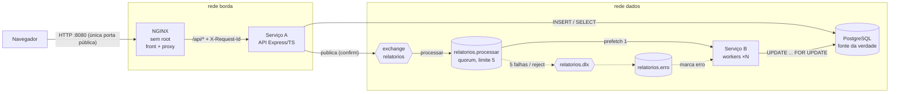
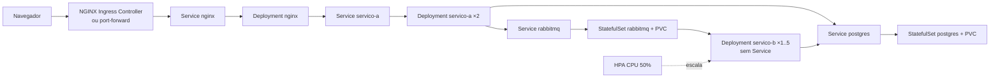
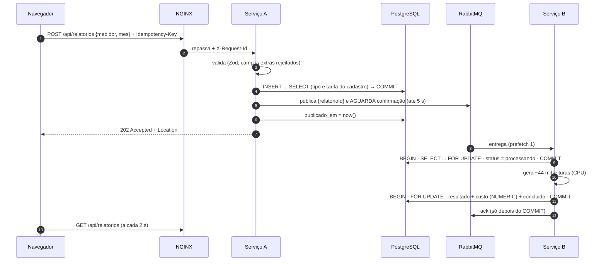

# WattReport: relatórios de consumo de energia sob demanda

Projeto da disciplina **Serviços em Nuvem** (Engenharia da Computação, Universidade Presbiteriana Mackenzie, 2026).

O usuário pede o relatório de consumo de um medidor em um mês. A API **aceita** o pedido, grava no PostgreSQL, publica um aviso de trabalho no RabbitMQ e responde `202 Accepted`. Um ou mais *workers* **executam** o trabalho em segundo plano: simulam 1 leitura por minuto do mês inteiro (cerca de 44 mil leituras) e calculam consumo, custo, média diária, pico e consumo por dia.

A ideia central é separar **aceitar** o trabalho de **executar** o trabalho. A capacidade de processamento cresce multiplicando os workers, sem mexer na API.

---

## 1. Arquitetura

### 1.1 Docker Compose (etapa 1)



### 1.2 Kubernetes (etapas 2 e 3)



### 1.3 Papel de cada componente

| Componente | Papel |
|---|---|
| **NGINX** | Único ponto de entrada. Serve o front, faz *proxy* de `/api/*` para o Serviço A e gera o `X-Request-Id`. Limita requisições por IP (429), esconde `/api/health/*`, roda sem root. |
| **Serviço A** | API (Node 22, Express 5, TypeScript, Zod). Valida, grava o relatório `pendente`, publica a mensagem com confirmação do broker e responde 202. **Não executa o trabalho pesado.** Mantém o outbox e o reconciliador. |
| **PostgreSQL** | **Fonte da verdade.** Se o banco diz que o relatório está `concluido`, essa é a situação válida. Guarda tarifas, medidores e relatórios. |
| **RabbitMQ** | Transporta **avisos de trabalho** (não o estado). Distribui os avisos entre os workers (*work queue*). |
| **Serviço B** | Worker. Consome a fila, trava o relatório no banco, gera o resultado e conclui numa transação. Só então envia o ack. Também consome a fila de erro. |

**Desacoplamento:** A e B nunca se chamam (nem HTTP, nem TCP). O A só conhece o banco e a exchange; o B só conhece a fila e o banco. O B pode ter 0, 1 ou 5 réplicas sem o A saber.

---

## 2. Fluxo de um pedido



### Rastreamento
Todos os logs são **JSON** e levam o mesmo `requestId` (e o `relatorioId`):

```bash
docker compose logs | grep <requestId>
```

---

## 3. API (Serviço A)

| Rota | Descrição | Respostas |
|---|---|---|
| `POST /api/relatorios` | Body `{"medidor": 42, "mes": "2026-10"}`. Cabeçalho opcional `Idempotency-Key`. | **202** · **200** (repetição, `Idempotent-Replayed: true`) · 400 · 422 (medidor não cadastrado) · 429 |
| `GET /api/relatorios?status=&medidor=&limite=` | Lista, do mais recente para o mais antigo | 200 · 400 |
| `GET /api/relatorios/stats` | Contagens (do banco), aguardando publicação (outbox), fila e workers (do RabbitMQ) | 200 |
| `GET /api/relatorios/:id` | Detalhe com resultado | 200 · 400 · 404 |
| `GET /api/health/live` / `ready` | **Internos** (o NGINX responde 404 para o público) | 200 · 503 |

- O cliente informa **só o medidor e o mês**. Tipo de consumidor e tarifa vêm do banco, então o cliente não controla o valor cobrado.
- Erros 4xx dizem qual campo está errado. Erros 500 devolvem só uma mensagem genérica e o `requestId`; o detalhe fica no log.

### Organização do código (padrão do documento TaskFlow)

```
servico-a/src
├── server.ts           liga tudo, keep-alive, encerramento gracioso
├── app.ts              monta o Express (usado também pelos testes)
├── container.ts        composition root
├── config/             variáveis de ambiente validadas com Zod (encerra se faltar algo)
├── domain/ dtos/ mappers/ errors/
├── middlewares/        validate, request-id, not-found, error-handler
├── routes/ controllers/
├── services/           RelatorioService, Reconciliador (outbox), estatísticas
├── repositories/       interface + PostgreSQL + em memória (testes)
├── messaging/          topologia.ts (igual no B), ConexaoRabbitMq (confirms + reconexão)
└── db/pool.ts          pool limitado a 10 conexões
```

---

## 4. Banco de dados (`database/`)

| Arquivo | Conteúdo |
|---|---|
| `01-schema.sql` | Tabelas `tarifa`, `medidor` e `relatorio`, com `CHECK`, `UNIQUE` e `REFERENCES`, índices e *trigger* de `atualizado_em` |
| `02-dados-iniciais.sql` | 3 tarifas e 200 medidores. Os múltiplos de 25 estão **desativados** (servem para demonstrar o erro de negócio). |
| `03-usuario-app.sh` | Usuário da aplicação com **privilégio mínimo**: só `SELECT`, `INSERT` e `UPDATE`. Não tem `DELETE` nem DDL. |

Os scripts rodam só na **primeira** subida (volume vazio). Para recriar: `docker compose down -v`.

---

## 5. RabbitMQ: topologia e mensagens

| Item | Valor |
|---|---|
| vhost / usuário | `wattreport` / do `.env` (sem `guest`) |
| Exchange principal | `relatorios` (direct), routing key `processar` |
| Fila principal | `relatorios.processar`: **quorum**, durável, `x-delivery-limit: 5`, dead-letter para `relatorios.dlx` |
| Dead-letter | `relatorios.dlx` (fanout) → `relatorios.erro` (quorum), consumida pelo worker |

**Mensagem** (aviso de trabalho; o estado está no banco):

```json
{ "versao": 1, "relatorioId": "e78851bc-86f9-4efe-a5f7-dbeb3beec4c6", "requestId": "a8fa9b93b3839b43d13da3f41a267b0e" }
```

Propriedades: `persistent: true`, `messageId = relatorioId`, `correlationId = requestId`. A topologia está em `messaging/topologia.ts`, arquivo **idêntico** nos dois serviços.

**O que o worker faz com cada mensagem:**

| Situação | Tipo | Ação |
|---|---|---|
| Processou e gravou | sucesso | `ack` (só depois do COMMIT) |
| Relatório já `concluido` ou `erro` (mensagem repetida) | idempotência | `ack`, sem refazer nada |
| Medidor desativado | **erro de negócio** | status `erro` + `ack` (repetir não muda a realidade) |
| Banco fora ou falha simulada | **erro técnico** | `nack` com *requeue*. Na 5ª reentrega, vai para a dead-letter. |
| JSON inválido / fora do contrato / relatório inexistente | mensagem venenosa | `reject` sem *requeue* → dead-letter direto |
| Chegou na `relatorios.erro` | dead-letter | o worker marca o relatório como `erro` (nunca fica em "processando" para sempre) |

---

## 6. Decisões do projeto (e o que acontece sem elas)

| Decisão | Sem ela | Onde |
|---|---|---|
| `prefetch = 1` | Um worker reserva muitas mensagens e os workers novos ficam ociosos | Worker |
| Quorum queue + mensagens persistentes | Reiniciar o broker pode apagar trabalho pendente | RabbitMQ |
| `x-delivery-limit` + dead-letter + worker consumindo a fila de erro | Mensagem venenosa circula para sempre; relatório preso em "processando" | RabbitMQ / Worker |
| Exchange nomeada | Produtor acoplado ao nome da fila | RabbitMQ |
| Topologia idêntica em A e B | `PRECONDITION_FAILED` dependendo de quem sobe primeiro | RabbitMQ |
| Publisher confirms (5 s) | A API acha que publicou algo que o broker não recebeu | Serviço A |
| Publicar **depois** do COMMIT | Worker recebe aviso de um relatório que ainda não existe | Serviço A |
| **Outbox + reconciliador** (5 s, `SKIP LOCKED`) | Pedido gravado mas nunca publicado se o broker cair | Serviço A |
| API reconecta ao RabbitMQ em segundo plano | Queda do broker derruba também a API | Serviço A |
| `Idempotency-Key` + `UNIQUE` | Retry do cliente cria o mesmo relatório duas vezes | Serviço A / Banco |
| Tipo e tarifa vindos do banco, copiados no pedido | Cliente define o próprio preço; mudança de tarifa altera relatórios antigos | Serviço A / Banco |
| Dinheiro em `NUMERIC`, custo calculado em SQL | Erros de arredondamento de ponto flutuante | Banco |
| `SELECT ... FOR UPDATE` + idempotência no worker | Cópias duplicadas da mensagem concluem em paralelo | Worker |
| Resultado e status na mesma transação | Relatório com resultado pela metade | Worker |
| Erro de negócio × erro técnico | Erro permanente repetido à toa; erro temporário cancelando pedidos válidos | Worker |
| Worker *fail fast* ao perder o broker | Worker "vivo" sem consumir, com a fila crescendo em silêncio | Worker |
| Encerramento gracioso (SIGTERM) | Escala e atualização cortam trabalho no meio | A / B |
| Health `live` × `ready` (RabbitMQ fora da readiness) | Reinicializações em cadeia que não resolvem nada | A |
| Logs JSON + `X-Request-Id` | Impossível seguir um pedido entre NGINX, réplicas e workers | Todos |
| Pool limitado (A: 10, B: 5) | Escalar réplicas esgota as conexões do PostgreSQL | A / B |
| Usuário do banco com privilégio mínimo | Bug ou invasão com poder de administrador | Banco |
| `proxy_pass` sem barra + keep-alive coerente | 404 em rotas válidas; 502 intermitente | NGINX |
| Limite por IP (429) e sem retry de POST no proxy | Um cliente ocupa tudo; POST duplicado | NGINX |
| Multi-stage, usuário `node`, `CMD ["node", ...]`, `.dockerignore` | Imagem grande, root, SIGTERM perdido, segredo na imagem | Docker |
| Redes separadas e só a porta do NGINX publicada | NGINX comprometido alcança banco e broker | Compose |
| `read_only`, `cap_drop`, limites de CPU e memória | Container gravável e sem teto de consumo | Compose / K8s |
| Versões de imagem fixas | Ambiente muda sozinho quando sai uma versão nova | Compose / K8s |
| Kustomize gerando ConfigMaps/Secret com hash | Configuração duplicada; Pods com configuração antiga | K8s |
| StatefulSet para PostgreSQL e RabbitMQ | Perda de identidade e de volume dos componentes com estado | K8s |
| `securityContext` restritivo, requests e limits | Pods com privilégios e consumo sem controle | K8s |

---

## 7. Como executar

**Etapa 1 (Compose):**
```bash
cp .env.example .env            # troque as senhas (só letras e números)
docker compose config           # confere as variáveis
docker compose up -d --build
docker compose ps               # tudo "healthy"
# http://<ip-da-vm>:8080
```

**Testes automatizados** (sem Docker, sem banco, sem broker):
```bash
cd servico-a && npm install && npm test     # 17 testes
cd ../servico-b && npm install && npm test  # 10 testes
```

**Etapas 2 e 3 (Minikube):**
```bash
docker compose down
minikube start --driver=docker --cpus=4 --memory=6g
minikube addons enable metrics-server        # para o HPA
minikube addons enable ingress               # opcional (ponto de entrada pelo Ingress)
./scripts/k8s-imagens.sh                     # build das imagens no Docker do Minikube
kubectl apply -k .                           # Kustomize: tudo, a partir dos mesmos arquivos do Compose
kubectl get pods -n wattreport -w
kubectl port-forward -n wattreport svc/nginx 8080:80
kubectl port-forward -n wattreport svc/rabbitmq 15672:15672   # painel (opcional)
```

---

## 8. Experimentos

| # | Experimento | Comandos | Resultado esperado |
|---|---|---|---|
| 1 | Fila acumulando sem worker | `docker compose stop servico-b` · `./scripts/carga.sh 5 1` · `docker compose start servico-b` | Consumers 0 e ~5 Ready; depois Ready cai a 0 e tudo conclui |
| 2 | Escala de consumidores | `docker compose up -d --scale servico-b=1` · `./scripts/carga.sh 60 10` · `docker compose up -d --scale servico-b=4` | Consumers 1 → 4; fila esvazia bem mais rápido |
| 3 | Worker morto no meio | `./scripts/carga.sh 10 2` · `docker compose kill -s SIGKILL servico-b` · `docker compose up -d servico-b` | Unacked volta a Ready; relatório conclui com `tentativas: 2` |
| 4 | Desligamento gracioso | `./scripts/carga.sh 10 2` · `docker compose stop servico-b` · `docker compose logs servico-b` | `processo.encerrando` → termina o atual → `processo.encerrado` |
| 5 | Falha técnica e dead-letter | `TAXA_FALHA_SIMULADA=0.5 docker compose up -d servico-b` · `./scripts/carga.sh 20 5` | Redelivered cresce; alguns relatórios vão a `erro` após o limite |
| 6 | RabbitMQ indisponível | `docker compose stop rabbitmq` · `./scripts/carga.sh 5 1` · `docker compose start rabbitmq` | API segue respondendo 202 ("aguardando publicação"); workers reiniciam; ao voltar, o reconciliador publica |
| 7 | Erro de negócio | `curl -X POST localhost:8080/api/relatorios -H 'Content-Type: application/json' -d '{"medidor":25,"mes":"2026-10"}'` | 202 e depois status `erro` ("Medidor 25 está desativado"), sem reentregas |
| 8 | Cliente repete o POST | mesmo `Idempotency-Key` duas vezes (ver GUIA) | 202 na 1ª, 200 + `Idempotent-Replayed` na 2ª, mesmo id |
| 9 | Self-healing (K8s) | `kubectl scale deployment servico-b -n wattreport --replicas=3` · `kubectl delete pod -n wattreport <pod>` | O Deployment recria o Pod |
| 10 | Escala manual (K8s) | `kubectl scale deployment servico-b -n wattreport --replicas=5` | Consumers 5, Unacked até 5 |
| 11 | Elasticidade, HPA (K8s) | `kubectl scale ... --replicas=1` · `kubectl apply -f k8s/hpa-servico-b.yaml` · `./scripts/carga.sh 400 20` | Réplicas sobem até 5 e descem quando a fila esvazia |

**Escalabilidade × elasticidade:** no experimento 10 uma pessoa decide o número de réplicas. No 11, o ambiente decide sozinho pela demanda (CPU), que é a "elasticidade rápida" da definição de nuvem do NIST.

---

## 9. Limitações conhecidas
- PostgreSQL e RabbitMQ com uma instância cada: não há alta disponibilidade.
- Entrega "pelo menos uma vez": um relatório pode ser processado mais de uma vez em caso de falha. O efeito é um só (idempotência + `FOR UPDATE`).
- O HPA usa CPU como medida indireta da demanda; escalar pelo tamanho da fila (KEDA) seria mais fiel.
- As leituras são simuladas (determinísticas por medidor e mês).
